<a href="mailto:nimayanki@gmail.com"><picture><source media="(prefers-color-scheme: dark)" srcset="assets/pill-email-dark.svg"></picture></a>
<a href="https://www.linkedin.com/in/nimayankireddypalli/"><picture><source media="(prefers-color-scheme: dark)" srcset="assets/pill-linkedin-dark.svg"></picture></a>
<a href="https://rallocoach.com"><picture><source media="(prefers-color-scheme: dark)" srcset="assets/pill-rallo-dark.svg"></picture></a>

<picture>
  <source media="(prefers-color-scheme: dark)" srcset="assets/graph-dark.svg">
  
</picture>

Founder who builds his own products, from hardware and iOS apps to AI tools and websites. Business student at the University of South Carolina's Darla Moore School of Business.

#### Building

-  **Founder, [Rallo](https://rallocoach.com)**
  - Smart pickleball paddle sensor and iOS coaching app. Built the firmware, the app and the shot-classification work myself.
-  **Founder & CEO, [PermitBug](https://permitbug.com)**
  - AI permit pre-screening for contractors, trained on real Denver permit rejections. Got paying subscribers within the first month by cold-calling 200+ contractors.

#### Side builds

- **Alpha Kappa Psi chapter website.** Next.js, Tailwind, Framer Motion.
- **Sonic Galaxy.** Spotify music visualizer on HTML5 canvas.
- **JARVIS.** Raspberry Pi smart home assistant.

#### School

- B.S. Business Administration, Marketing and Operations & Supply Chain, minor in Psychology. Class of 2029.
- President's List, Dean's List. Alpha Kappa Psi.
